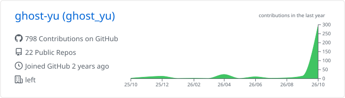

<b>the other</b>

### 01 / About me

你好，我是 **ghost-yu**，一名 CS / AI 方向的大学生。

<strong>Systems</strong>

<strong>Development</strong>

<strong>Graphics & Intelligence</strong>

### 02 / Beyond code

喜欢 **BL 小说**，热爱研究 **心理学与哲学**。 做做二次元研究或者别的。

福柯 Michel Foucault · 列维纳斯 Emmanuel Levinas · 布朗肖 Maurice Blanchot · 德勒兹 Gilles Deleuze

### 03 / On GitHub

<picture>
  <source media="(prefers-color-scheme: dark)" srcset="./profile/stats-dark.svg" />
  
</picture>
<picture>
  <source media="(prefers-color-scheme: dark)" srcset="./profile/languages-dark.svg" />
  
</picture>

  

<picture>
  <source media="(prefers-color-scheme: dark)" srcset="./profile-summary-card-output/tokyonight/0-profile-details.svg" />
  
</picture>

<b>更多 Metrics · 语言分布与立体贡献日历</b>

 

### 04 / A little snake

<picture>
  <source media="(prefers-color-scheme: dark)" srcset="./profile/snake-dark.svg" />
  
</picture>

 
Code, books, and unfinished questions.

Built with open-source profile components · <a href="./CREDITS.md">Credits</a>

